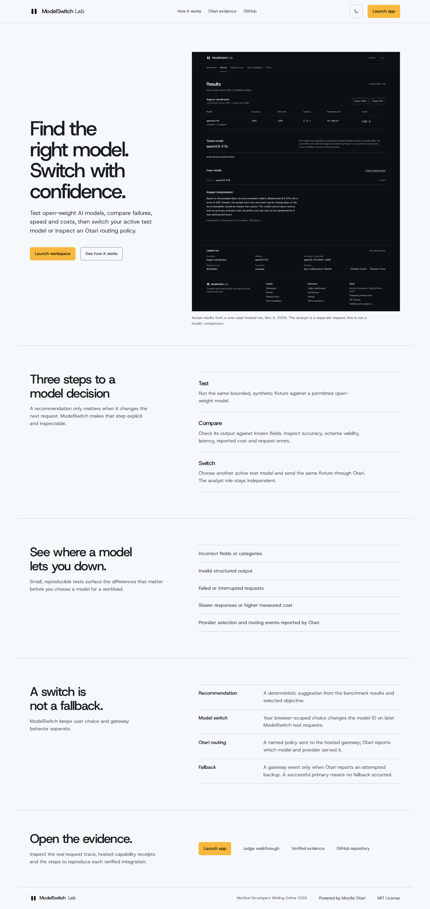

<p align="center"></p>

# ModelSwitch Lab

**Test open-weight models, compare their failures, then switch your active test model through Mozilla’s hosted Otari gateway.**

**Live demo:** [modelswitch-lab.vercel.app](https://modelswitch-lab.vercel.app) · **[Judge walkthrough](docs/JUDGE_WALKTHROUGH.md)** · [GitHub](https://github.com/sopskistar/modelswitch-lab)

**Production check (Nov 5, 2026):** The landing and Model Switch pages now load on the official site. A live browser check verified catalog discovery, manual model selection without inference, desktop/mobile layout, and zero axe violations. The exact Vercel source SHA remains unavailable; see the [redacted production check](evidence/production-deployment-check.json).



[Model Switch desktop](docs/screenshots/production-model-switch-desktop.png) · [Model Switch mobile](docs/screenshots/production-model-switch-mobile.png)

## Why it is useful

- Run the same synthetic task against supported models and score answers against known fields.
- See measured accuracy, failures, latency, and gateway-reported cost before choosing a model.
- Switch the model used by later ModelSwitch requests and inspect Otari’s actual serving identity and routing metadata.

The active choice applies to ModelSwitch Lab test requests only. It does not change a developer’s external application. A manual model switch is separate from an Otari policy fallback.

## Judge? Start here

Open the [live app](https://modelswitch-lab.vercel.app), follow the [walkthrough](docs/JUDGE_WALKTHROUGH.md), then inspect [redacted request evidence](docs/OTARI_PROOF.md) and the [rubric matrix](docs/RUBRIC_EVIDENCE.md). A four-minute personal recording outline is in [DEMO_SCRIPT.md](docs/DEMO_SCRIPT.md).

## How it works

1. **Test** a fixed benchmark case with Qwen or Llama.
2. **Compare** deterministic correctness with observed latency and reported cost.
3. **Switch** the browser-scoped active test model; the next explicit request uses that model ID through hosted Otari.

## Otari and model roles

Every model request goes through Mozilla’s hosted [Otari](https://github.com/mozilla-ai/otari) gateway. The server reads effective model, provider, request ID, routing and usage metadata from Otari; it never calls model providers directly.

- **Qwen3.8 27B** (Apache 2.0 weights) is the configured evaluator and performs benchmark tasks. [Model card](https://huggingface.co/Qwen/Qwen3.8-27B).
- **Llama 3.3 70B Instruct** (Meta Llama Community License) is the separate analyst for verified metrics and is also available for explicit same-fixture model tests. [Model card and license](https://huggingface.co/meta-llama/Llama-3.3-70B-Instruct).

The latest bounded production switch check confirmed a Llama response from Otari (`bedrock`, request `77cf5458-46f6-40c9-98ab-80468ba890ec`, six fields correct, reported cost $0.000170). Its Qwen request timed out without a gateway request ID; no retry was made. This confirms a successful Llama route and records the Qwen failure, but does not establish a fresh two-model comparison. See [the full redacted receipt](evidence/model-switch-production.json).

The analyst interprets deterministic results and cannot change their scores. The app also provides reproducible invoice extraction, support classification, and bounded reasoning scenarios. Small test sets characterize only those cases, not universal model quality.

## Verified evidence

The project evidence assessment is **up to 85/100 potential points**, not an official score. It includes two open-weight model roles, hosted code execution, distinct model roles, policy routing (successful primary; fallback unobserved), a completed Otari-managed MCP call, a working use case, and verified Otari key-scoped request-count enforcement. The isolated budget receipt shows one admitted request followed by an Otari `budget_exceeded` refusal; its first answer content was empty. No actual fallback event or sixth advanced capability is verified; web fetch, guardrails, per-user budgets, and the personal recording remain unverified. Review the [rubric matrix](docs/RUBRIC_EVIDENCE.md), [Otari proof](docs/OTARI_PROOF.md), and [budget receipt](evidence/budget-enforcement-test.json).

## Architecture and local setup

Next.js App Router and TypeScript serve the landing page at `/` and the workbench at `/app`. Server route handlers validate bounded requests and call hosted Otari. Deterministic scoring runs in the app; recent runs and active model choice stay in browser storage. There is no application database.

```sh
npm ci
cp .env.example .env.local
# Add the required server-only Otari settings.
npm run dev
```

Required settings: `OTARI_API_KEY`, `OTARI_BASE_URL`, `OTARI_EVALUATOR_MODEL`, and `OTARI_ANALYST_MODEL`. The routing policy is optional. Public inference should remain disabled unless an Otari spending ceiling and durable Upstash limiter are configured. Never commit `.env.local`.

## Tests and documentation

```sh
npm run typecheck
npm run lint
npm test
npm run format:check
npm run build
npm run test:browser
```

Browser tests use intercepted requests for UI contracts and do not count as hosted execution. See [test results](docs/TESTING.md), [architecture](docs/ARCHITECTURE.md), [integration and deployment](docs/OTARI_INTEGRATION.md), [limitations](docs/LIMITATIONS.md), [submission checklist](docs/SUBMISSION_CHECKLIST.md), and [observed Otari feedback](docs/OTARI_FEEDBACK.md).

## License and acknowledgment

ModelSwitch Lab is available under the [MIT License](LICENSE). Built for MozFest Developers Wilding Online 2026 and powered by Mozilla’s hosted Otari.
