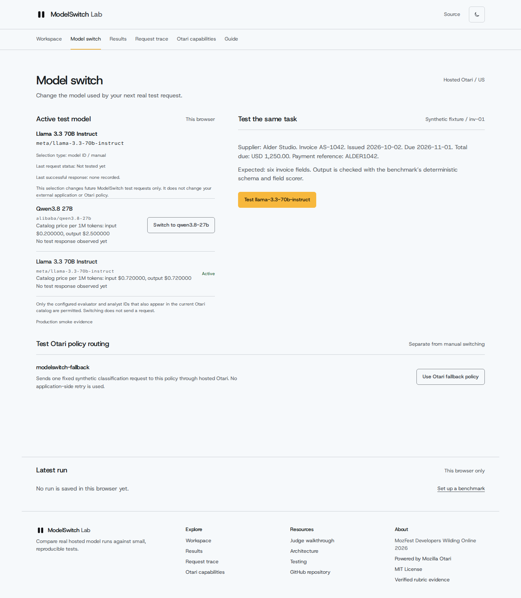

<p align="center">
  
</p>

# ModelSwitch Lab

**Test models. Understand failures. Switch with evidence.**

ModelSwitch Lab is a developer workbench for evaluating open-weight AI models through **Mozilla Otari**. Run the same known-answer task against supported models, inspect output quality, latency, cost and request failures, then **select the model to use for the next test**. It combines deliberate model switching with visibility into Otari's separate gateway routing and tool capabilities.

**[Live product](https://modelswitch-lab.vercel.app)** · **[Launch workspace](https://modelswitch-lab.vercel.app/app?view=workspace)** · **[Try Model Switch](https://modelswitch-lab.vercel.app/app?view=model-switch)** · **[Judge walkthrough](docs/JUDGE_WALKTHROUGH.md)** · **[Otari evidence](docs/OTARI_PROOF.md)**


## The problem

Choosing an AI model by a leaderboard alone doesn't tell a developer whether it will handle *their* task accurately, reliably or affordably. A model may return invalid JSON, miss required fields, take too long or fail entirely. Changing providers without comparable results can replace one problem with another.

**ModelSwitch Lab makes the decision inspectable:** test a fixed task, compare completed runs on the same fixture, investigate errors and costs, and explicitly switch the active test model.

## How it works

1. **Test** — Choose a synthetic, known-answer scenario: invoice extraction, support classification or bounded reasoning. Run a supported model through hosted Otari.
2. **Compare** — Inspect deterministic scores, invalid/missing outputs, failures, latency and reported usage/cost. A fair comparison requires completed results on the same test fixture.
3. **Decide and switch** — Open **Model Switch**, select Qwen or Llama and explicitly test the selected model. The next test uses that model ID. Selection itself sends **no** inference request and incurs no model cost.
4. **Inspect** — Review requested and effective model/provider metadata, request traces, receipts and documented Otari capability evidence.

**Important scope:** Model Switch changes the selection **inside this workbench**; it does not silently update another developer application, rewrite an Otari routing policy or prove automatic failover. Model recommendations only describe the small evaluated dataset. A separate Llama *analyst* role interprets results; it is not counted as a second evaluator unless actually run on the same fixture.



## For judges and first-time visitors

**Start here: [Five-minute judge walkthrough](docs/JUDGE_WALKTHROUGH.md).** It gives an ordered, click-by-click path through the live app, Model Switch, Results, Request Trace and verified Otari evidence. A **read-only route** is available; you do **not** need credentials or paid inference to inspect the recorded evidence.

To explore quickly:

1. Visit the [landing page](https://modelswitch-lab.vercel.app), then choose **Launch workspace**.
2. Inspect the three synthetic task types and their expected outputs.
3. Open [Model Switch](https://modelswitch-lab.vercel.app/app?view=model-switch). Change the active model from Qwen to Llama and back; changing the selection alone does not submit a request.
4. Inspect **Results**, **Request Trace** and **Otari capabilities**. For completed historic runs and actual gateway receipts, use the [evidence guide](docs/OTARI_PROOF.md).

Running a new benchmark is **optional** and incurs actual hosted inference usage. Public execution may be unavailable or limited by safety and spending controls. If a request times out, do not assume it completed or retry automatically.

## What's implemented

| Area | Functionality |
| --- | --- |
| Model evaluation | Qwen 3.8 27B evaluator; Llama 3.3 70B analyst; explicit Llama evaluator testing |
| Model Switch | Browser-scoped active-model selection; explicit same-fixture test; evidence-based recommendation when comparable completed runs exist |
| Results | Deterministic scoring, field-level errors, latency, reported costs, and JSON/CSV exports |
| Observability | Otari request IDs, requested/effective model and provider, trace and error information when returned |
| Otari integrations | Policy routing, distinct model roles, hosted code execution, DeepWiki MCP, enforced API-key request budgets, native web fetch |
| Protection | Server-only credentials, model/case allowlists, bounded requests, and optional Upstash-backed public rate limits |

The verified routing receipt shows Otari resolved a policy to Qwen/DeepInfra, but **`fallback=false`**: actual gateway failover has **not** been demonstrated. A native web-fetch tool completed successfully, although its model-generated summary was incomplete. Guardrails and per-user budget enforcement are not claimed as verified.

**[Inspect the individual redacted receipts](docs/OTARI_PROOF.md)** · **[Rubric evidence and limitations](docs/RUBRIC_EVIDENCE.md)** · **[Testing methodology](docs/TESTING.md)**

## Architecture

```text
Browser (Next.js / React)
    │  choose synthetic task and active model
    ▼
Next.js server route (validation, request bounds)
    │  server-held Otari credentials
    ▼
Mozilla Otari gateway
    ├── Open-weight model inference / policy routing
    └── Hosted tools (code execution, MCP, web fetch)
    │
    ▼
Deterministic scoring + request metadata
    │
    ▼
Results, Model Switch, Request Trace and redacted receipts
```

Built with **Next.js App Router, React, TypeScript, Tailwind CSS and Zod**, deployed on **Vercel**. **Upstash Redis**, when configured, provides durable public rate limits. Recent run history, theme and active-model selection are browser-scoped; the app has no application database. API secrets are kept on the server.

## Run locally

Requires **Node.js 22**.

```bash
git clone https://github.com/sopskistar/modelswitch-lab.git
cd modelswitch-lab
npm ci
cp .env.example .env.local
```

Set `OTARI_API_KEY`, `OTARI_BASE_URL`, `OTARI_EVALUATOR_MODEL` and `OTARI_ANALYST_MODEL` in `.env.local`, following [Otari integration setup](docs/OTARI_INTEGRATION.md). Never commit credentials. Keep `PUBLIC_DEMO_ENABLED=false` unless hosted spending controls and durable request limiting are configured.

```bash
npm run dev
```

Useful checks: `npm run typecheck`, `npm run lint`, `npm test`, `npm run format:check`, `npm run build` and `npm run test:browser`. Browser tests use intercepted fixtures to verify UI behavior; **they do not count as live Otari execution evidence**.

Read [architecture details](docs/ARCHITECTURE.md), [test instructions](docs/TESTING.md) and [known limitations](docs/LIMITATIONS.md).

## Verified Otari evidence

The repository contains redacted hosted Otari execution receipts and a [judge walkthrough](docs/JUDGE_WALKTHROUGH.md). The [rubric matrix](docs/RUBRIC_EVIDENCE.md) maps the evidence to six advanced feature categories; it is a **potential assessment, not an official score**. Routing credit remains conditional because a real failover has not been observed.

## License

[MIT](LICENSE). Built for **MozFest Developers Wilding Online 2026**, using **Mozilla Otari**.
