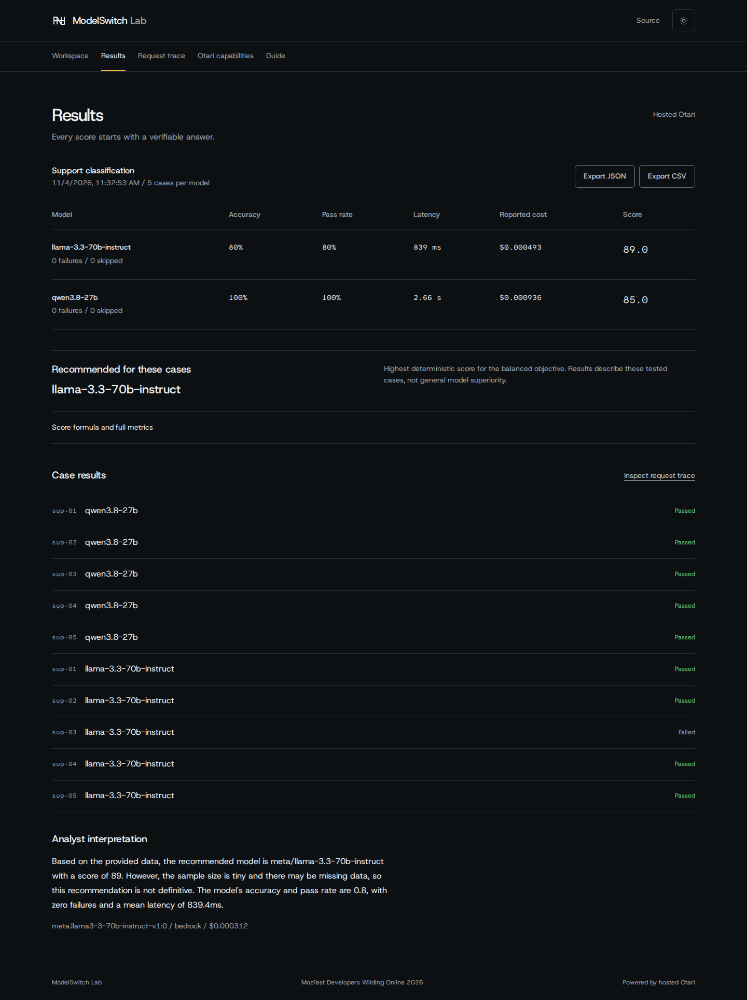

<p align="center"></p>

# ModelSwitch Lab

Run reproducible model evaluations through Mozilla's hosted Otari gateway and inspect the answers, usage, and routing evidence.

**Live demo:** [modelswitch-lab.vercel.app](https://modelswitch-lab.vercel.app)<br />
**Judge? Start here:** [Seven checkpoint walkthrough](docs/JUDGE_WALKTHROUGH.md) · [three minute demo outline](docs/DEMO_SCRIPT.md)



[Desktop workspace](docs/screenshots/desktop-light-workspace-live.png) · [mobile results](docs/screenshots/mobile-results-live.png)

## Why this is useful

- Test model answers against known, synthetic expected outputs.
- Compare accuracy, reliability, latency, and gateway-reported cost with visible scoring weights.
- Inspect each request, effective model, provider, usage, and failure instead of trusting a generated summary.

### How Otari powers it

The server sends all evaluator, analyst, routing, and sandbox requests through **hosted Otari**. ModelSwitch Lab uses the gateway's reported serving identity and usage, scores benchmark answers deterministically, and records request evidence. The application does not call model providers directly.

## Start judging

1. Open the [live demo](https://modelswitch-lab.vercel.app) and follow the [judge walkthrough](docs/JUDGE_WALKTHROUGH.md).
2. Review real prior run records in [`evidence/browser-smoke.json`](evidence/browser-smoke.json).
3. Check the [rubric evidence matrix](docs/RUBRIC_EVIDENCE.md) and [hosted Otari proof](docs/OTARI_PROOF.md).

The app runs three versioned synthetic benchmarks: invoice extraction, support classification, and bounded passage reasoning. Each has five cases. A browser can retain one recent run locally; JSON export creates a portable benchmark receipt. Tiny samples describe only the tested cases. The capabilities view includes fixed routing, sandbox, web, guardrail, and repository-MCP checks; a control is not evidence until Otari returns the corresponding live event.

## Open-weight model roles

- **Evaluator:** Qwen3.8 27B performs the benchmark task. The model card identifies Apache 2.0 weights: [Qwen3.8-27B](https://huggingface.co/Qwen/Qwen3.8-27B).
- **Analyst:** Llama 3.3 70B examines server-verified metrics in a separate Otari request. Its weights use Meta's [Llama 3.3 Community License](https://huggingface.co/meta-llama/Llama-3.3-70B-Instruct), with additional terms.

The analyst can explain a result but cannot change deterministic scores. A recorded five-case comparison started **2026-11-04 16:32:53 UTC** and scored Qwen 5/5 and Llama 4/5; the reported total including the analyst was $0.001741. These are timestamped historical observations, not current aggregate statistics or a general model ranking.

## Verified rubric coverage

Our evidence assessment supports **75/100 potential points**, not an official score: 30 for two meaningful open-weight model roles, 40 for distinct roles, hosted code execution, actual Otari policy routing, and a successful hosted MCP call, and 5 for the working application. The production routing request resolved `modelswitch-fallback` to Qwen through DeepInfra; it reported one attempt and `fallback=false`, so failover itself remains unverified. Routing and MCP receipts are recorded with request IDs and limitations. Gateway budget enforcement, web retrieval, guardrails and the personal demo recording remain unverified or unavailable. The production deployment still serves the previous unverified MCP evidence record; the exact deployed SHA is unknown. See the [matrix](docs/RUBRIC_EVIDENCE.md), [Otari proof](docs/OTARI_PROOF.md), [routing evidence](evidence/routing-production.json), and [MCP evidence](evidence/mcp-status.json).

## Architecture

Next.js App Router and TypeScript serve a small React workbench. Typed server routes call hosted Otari; Zod validates bounded requests and outputs; deterministic local scoring compares results. The interface retains one recent run in browser storage. There is no application database.

## Run locally

Requires Node.js 22 or newer and npm.

```sh
npm ci
cp .env.example .env.local
# Set the private server-side Otari key and accessible model IDs.
npm run dev
```

Open the local URL printed by Next.js. Without credentials, the workspace shows a setup-required state. Inference is disabled in the example environment. Do not commit `.env.local`.

| Variable                   | Purpose                                                        |
| -------------------------- | -------------------------------------------------------------- |
| `OTARI_API_KEY`            | Server-only hosted Otari inference key                         |
| `OTARI_BASE_URL`           | US or EU hosted API base                                       |
| `OTARI_EVALUATOR_MODEL`    | Accessible evaluator model ID                                  |
| `OTARI_ANALYST_MODEL`      | Distinct accessible analyst model ID                           |
| `OTARI_FALLBACK_POLICY`    | Optional accessible Otari routing policy                       |
| `PUBLIC_DEMO_ENABLED`      | Explicit public inference switch; keep `false` until protected |
| `UPSTASH_REDIS_REST_URL`   | Durable production request limiter                             |
| `UPSTASH_REDIS_REST_TOKEN` | Server-only limiter token                                      |

On Vercel, public inference requires both the explicit switch and durable Redis limits. It also requires an Otari-side hard spending boundary. A read-only catalog observation on the selected domain returned `demoEnabled: true`, which reflects environment presence rather than tested limiter behavior; the deployment commit and private settings are not independently available here. See [deployment and safety requirements](docs/OTARI_INTEGRATION.md#vercel-and-public-inference) and the [production evidence record](evidence/production-observation.json).

## Tests

```sh
npm run typecheck
npm run lint
npm test
npm run build
npm run test:browser
```

Browser contract tests intercept requests only inside the test process. They verify interface behavior, not live model performance. See [test coverage and results](docs/TESTING.md).

## Evidence and project notes

- [Hosted Otari proof and request records](docs/OTARI_PROOF.md)
- [Full rubric evidence and limitations](docs/RUBRIC_EVIDENCE.md)
- [Architecture](docs/ARCHITECTURE.md)
- [Testing](docs/TESTING.md)
- [Otari integration and setup](docs/OTARI_INTEGRATION.md)
- [Submission checklist](docs/SUBMISSION_CHECKLIST.md)
- [Observed Otari feedback](docs/OTARI_FEEDBACK.md)
- [Current limitations](docs/LIMITATIONS.md)

## License and acknowledgment

ModelSwitch Lab is available under the [MIT License](LICENSE). Built for MozFest Developers Wilding Online 2026 and powered by [Mozilla's hosted Otari](https://github.com/mozilla-ai/otari).
