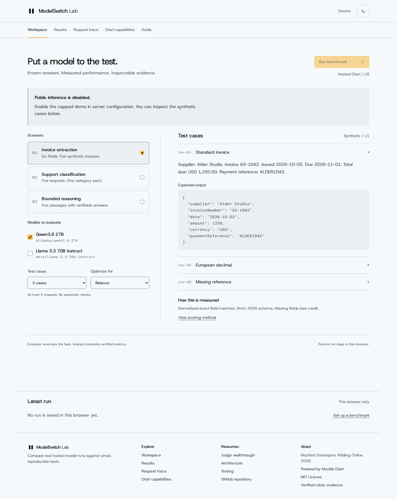

<p align="center"></p>

# ModelSwitch Lab

Run reproducible model evaluations through Mozilla's hosted Otari gateway and inspect the answers, usage, and routing evidence.

**Live demo:** [modelswitchlab.vercel.app](https://modelswitchlab.vercel.app) · public inference is currently disabled.<br />
**Judge? Start here:** [Seven checkpoint walkthrough](docs/JUDGE_WALKTHROUGH.md) · [three minute demo outline](docs/DEMO_SCRIPT.md)



[Production desktop capture](docs/screenshots/production-desktop-workspace.png) · [mobile capture](docs/screenshots/production-mobile-workspace.png)

## Why this is useful

- Test model answers against known, synthetic expected outputs.
- Compare accuracy, reliability, latency, and gateway-reported cost with visible scoring weights.
- Inspect each request, effective model, provider, usage, and failure instead of trusting a generated summary.

### How Otari powers it

The server sends all evaluator, analyst, routing, and sandbox requests through **hosted Otari**. ModelSwitch Lab uses the gateway's reported serving identity and usage, scores benchmark answers deterministically, and records request evidence. The application does not call model providers directly.

## Start judging

1. Read the [Judge walkthrough](docs/JUDGE_WALKTHROUGH.md) for the full click-by-click route.
2. See the [actual live comparison capture](docs/screenshots/desktop-results-live.png) and the redacted [run evidence](evidence/browser-smoke.json).
3. Check the [rubric evidence matrix](docs/RUBRIC_EVIDENCE.md) and [hosted Otari proof](docs/OTARI_PROOF.md).

The app runs three versioned synthetic benchmarks: invoice extraction, support classification, and bounded passage reasoning. Each has five cases. A browser can retain one recent run locally; JSON export creates a portable benchmark receipt. Tiny samples describe only the tested cases.

## Open-weight model roles

- **Evaluator:** Qwen3.8 27B performs the benchmark task. The model card identifies Apache 2.0 weights: [Qwen3.8-27B](https://huggingface.co/Qwen/Qwen3.8-27B).
- **Analyst:** Llama 3.3 70B examines server-verified metrics in a separate Otari request. Its weights use Meta's [Llama 3.3 Community License](https://huggingface.co/meta-llama/Llama-3.3-70B-Instruct), with additional terms.

The analyst can explain a result but cannot change deterministic scores. A recorded five-case comparison started **2026-11-04 16:32:53 UTC** and scored Qwen 5/5 and Llama 4/5; the reported total including the analyst was $0.001741. These are timestamped historical observations, not current aggregate statistics or a general model ranking.

## Verified rubric coverage

Evidence supports **55 of 100 potential points** from prior real Otari execution: 30 for two distinct open-weight roles, 20 for distinct model roles and hosted code execution, and 5 for the working use case. This is our evidence assessment, not an official judge score. Production currently loads with inference disabled, so the historical live requests are not presented as current production runs. Fallback, gateway budget enforcement, web tools, guardrails, and the personally recorded demo remain unverified or unavailable. See the [matrix](docs/RUBRIC_EVIDENCE.md) and [production acceptance record](evidence/production-acceptance.json).

## Architecture

Next.js App Router and TypeScript serve a small React workbench. Typed server routes call hosted Otari; Zod validates bounded requests and outputs; deterministic local scoring compares results. The interface retains one recent run in browser storage. There is no application database.

## Run locally

Requires Node.js 22 or newer and npm.

```sh
npm ci
cp .env.example .env.local
# Set the private server-side Otari key and accessible model IDs.
npm run dev
```

Open the local URL printed by Next.js. Without credentials, the workspace shows a setup-required state. Inference is disabled in the example environment. Do not commit `.env.local`.

| Variable                   | Purpose                                                        |
| -------------------------- | -------------------------------------------------------------- |
| `OTARI_API_KEY`            | Server-only hosted Otari inference key                         |
| `OTARI_BASE_URL`           | US or EU hosted API base                                       |
| `OTARI_EVALUATOR_MODEL`    | Accessible evaluator model ID                                  |
| `OTARI_ANALYST_MODEL`      | Distinct accessible analyst model ID                           |
| `OTARI_FALLBACK_POLICY`    | Optional accessible Otari routing policy                       |
| `PUBLIC_DEMO_ENABLED`      | Explicit public inference switch; keep `false` until protected |
| `UPSTASH_REDIS_REST_URL`   | Durable production request limiter                             |
| `UPSTASH_REDIS_REST_TOKEN` | Server-only limiter token                                      |

On Vercel, public inference requires both the explicit switch and durable Redis limits. It also requires an Otari-side hard spending boundary. Production is live but its configuration is not available in this workspace; the public catalog reports inference disabled. See [deployment and safety requirements](docs/OTARI_INTEGRATION.md#vercel-and-public-inference).

## Tests

```sh
npm run typecheck
npm run lint
npm test
npm run build
npm run test:browser
```

Browser contract tests intercept requests only inside the test process. They verify interface behavior, not live model performance. See [test coverage and results](docs/TESTING.md).

## Evidence and project notes

- [Hosted Otari proof and request records](docs/OTARI_PROOF.md)
- [Full rubric evidence and limitations](docs/RUBRIC_EVIDENCE.md)
- [Architecture](docs/ARCHITECTURE.md)
- [Testing](docs/TESTING.md)
- [Otari integration and setup](docs/OTARI_INTEGRATION.md)
- [Submission checklist](docs/SUBMISSION_CHECKLIST.md)
- [Observed Otari feedback](docs/OTARI_FEEDBACK.md)
- [Current limitations](docs/LIMITATIONS.md)

## License and acknowledgment

ModelSwitch Lab is available under the [MIT License](LICENSE). Built for MozFest Developers Wilding Online 2026 and powered by [Mozilla's hosted Otari](https://github.com/mozilla-ai/otari).
