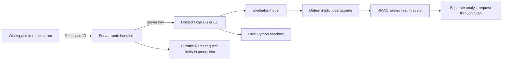

# Architecture

ModelSwitch Lab is a Next.js App Router application, with React, TypeScript,
Tailwind v4, CSS design tokens, and Zod. It needs no application database.
The source lockfile selects the actual tested dependency versions.

`src/lib/otari.ts` is server-only. It accepts only the two documented hosted
bases, uses bearer authentication, refuses redirects, and performs bounded
non-streaming calls with an AbortController. It makes no automatic inference
retries. Idempotency keys identify each run/model/case combination. A timeout
can still incur charges; it is never reported as a free request.

`GET /api/catalog` caches discovery for 60 seconds and shares in-flight discovery
per process. Only the two configured role models and the configured policy are
returned to the browser. Provider ownership in the catalog is not treated as
the provider that served a request. Serving identity comes from response headers.

`POST /api/execute` accepts only versioned synthetic fixture IDs, an allowlisted
model, a run UUID, and predefined experiment names. It checks Origin when present,
strict body schemas, streaming byte limits (64 KiB), model availability, output
limits, and rate limits. It never accepts arbitrary prompts, code, management
credentials, MCP server URLs, or arbitrary source URLs. Missing Origin is allowed
for CLI clients; rate limits and server-side restrictions still apply.

The browser submits one case at a time and publishes each result progressively.
At most two upstream operations run in a server process. Each route invocation
performs one bounded task; the analyst is a separate invocation. The maximum
normal run is 10 case requests plus one analyst request. The UI can stop before
the next case. It does not cancel an admitted gateway request or automatically
resume after reload.

Receipts bind verified case metrics to a run for one hour using an HMAC derived
from the server key and a versioned domain prefix. The analyst endpoint rejects
forgeries, expired receipts, another run's receipts, and duplicate cases. It
recomputes deterministic summaries on the server; the analyst cannot override
scores. Receipt signing is application security, not an Otari rubric feature.

Production public inference requires `PUBLIC_DEMO_ENABLED=true` and the two
Redis REST credentials. An atomic Redis script enforces 120 attempted inference
operations per UTC day globally and 12 per client per minute. Failed limiter
requests fail closed. The client fingerprint is a hash of the platform-supplied
forwarded IP; Vercel must remain the trusted ingress. Local development uses
process-local counters, which reset at restart and are not production controls.
Two-per-process concurrency is not a global distributed semaphore.

The application rate cap supplements a real Otari key/workspace budget. It is
not a dollar guarantee or evidence of gateway budget enforcement. Configure a
small hard Otari budget before enabling public access.

Recent results, trace, and theme use browser localStorage. There is no shared
history or result lookup by URL. Reloading restores completed cases and marks a
running session interrupted. Exports are the durable, portable result artifact.
Otari keeps its own account-side telemetry. No personal benchmark data is used.

Evidence files are reviewed, sanitized static records. `/api/evidence` serves
only explicitly imported files, never a filesystem path supplied by the browser.
The capability matrix represents checked-in evidence, not an optimistic reading
of available tools. New check results can be exported for operator review.

Deployment uses Node.js functions with 30-second limits and 22-second gateway
timeouts. The build uses Next's supported webpack option because this execution
environment blocked Turbopack's CSS worker port. Fonts and licenses are local;
builds do not require a Google Fonts connection.
